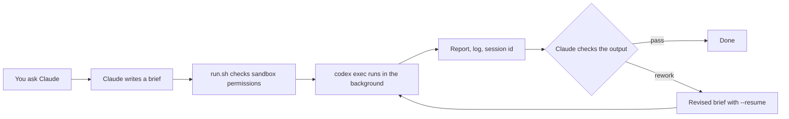

# codex-bridge

**Let Claude Code plan and review while your local Codex CLI does the long work.**

A Claude Code skill that hands well-defined tasks to `codex exec` in the background. Claude writes a self-contained brief, waits for the finish notification, then checks the actual output. Long test runs and large edits stop eating your Claude context.

[中文说明](README.zh-CN.md)



## What it does

- **Runs Codex in the background.** Claude gets notified when it finishes, so nothing polls.
- **Keeps Codex sandboxed.** Every run uses `--sandbox workspace-write`. Extra writable folders must be named with `--add-dir`.
- **Checks results against the files.** The skill tells Claude to verify deliverables and rerun key tests instead of trusting Codex's summary.
- **Catches a Windows sandbox failure up front.** If Codex cannot set permissions on the working folder, every command inside it fails with `setup refresh had errors`. The preflight check stops before you spend tokens and prints the exact `icacls` fix.
- **Resumes the same session.** Use `--resume <session-id>` for rework or after an interruption.

## Requirements

- Windows with Git Bash
- [Codex CLI](https://github.com/openai/codex), logged in
- Claude Code

`run.sh` calls PowerShell and `cygpath`, so it does not run on macOS or Linux as is.

## Install

```bash
git clone https://github.com/Hyc-12138/codex-bridge ~/.claude/skills/codex-bridge
```

If Codex CLI is not on your PATH, set `CODEX_BRIDGE_BIN` to its full path.

## Use

In Claude Code, say "hand this to Codex" or "走 Codex 桥". The workflow and brief format are in [SKILL.md](SKILL.md), which is written in Chinese.

You can also run the scripts directly:

```bash
bash scripts/run.sh --cd <workdir> --brief <brief.md> [--report report.md] [--log codex_run.log]
bash scripts/status.sh <codex_run.log>
```

The default model is `gpt-6.1-sol` with effort `xhigh`. Change them with `--model` and `--effort`.

Output from a real run (paths and the session id replaced; script messages are in Chinese):

```text
== Codex 桥结束 ==
工作目录: <workdir>
退出码: 0
会话id: <session-id>
用量: 8,022
```

| File | Purpose |
|---|---|
| `scripts/run.sh` | Runs the preflight check and one `codex exec`, then prints exit code, session id, usage and report path |
| `scripts/status.sh` | Shows the progress of a run |
| `scripts/preflight.ps1` | Checks that the Codex sandbox can set permissions on the working folder |

## License

[Apache-2.0](LICENSE)
