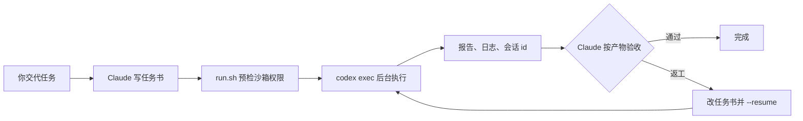

# codex-bridge

**Claude Code 负责规划和验收，长活交给本机 Codex CLI。**

一个 Claude Code skill：把有明确产物的任务交给 `codex exec` 后台执行。Claude 写自洽的任务书，等结束通知，再按实际产物验收。长测试和大段改码不再占用 Claude 的上下文。

[English](README.md)



## 能做什么

- **后台执行**：跑完通知 Claude，不用轮询。
- **留在沙箱里**：每次都用 `--sandbox workspace-write`，额外的可写目录要用 `--add-dir` 明确写出。
- **按文件验收**：skill 要求 Claude 核对交付物、重跑关键测试，不采信 Codex 自述。
- **提前拦住 Windows 沙箱故障**：Codex 改不了工作目录权限时，里面所有命令都会报 `setup refresh had errors`。预检会在花 token 前停下，并打印对应的 `icacls` 修复命令。
- **续跑同一会话**：返工或中断后用 `--resume <会话id>`。

## 环境

- Windows + Git Bash
- 已登录的 [Codex CLI](https://github.com/openai/codex)
- Claude Code

`run.sh` 调用 PowerShell 和 `cygpath`，目前不能直接在 macOS、Linux 上运行。

## 安装

```bash
git clone https://github.com/Hyc-12138/codex-bridge ~/.claude/skills/codex-bridge
```

Codex CLI 不在 PATH 里时，把环境变量 `CODEX_BRIDGE_BIN` 设为它的完整路径。

## 使用

在 Claude Code 里说“走 Codex 桥”或“交给 Codex 跑”。流程和任务书要求见 [SKILL.md](SKILL.md)。

也可以直接跑脚本：

```bash
bash scripts/run.sh --cd <工作目录> --brief <任务书.md> [--report 报告.md] [--log codex_run.log]
bash scripts/status.sh <codex_run.log>
```

默认模型 `gpt-6.1-sol`，effort `xhigh`，可用 `--model`、`--effort` 改。

一次真实运行的输出（路径和会话 id 已替换）：

```text
== Codex 桥结束 ==
工作目录: <工作目录>
退出码: 0
会话id: <会话id>
用量: 8,022
```

| 文件 | 作用 |
|---|---|
| `scripts/run.sh` | 预检沙箱权限，跑一次 `codex exec`，打印退出码、会话 id、用量和报告位置 |
| `scripts/status.sh` | 查看一次运行的进度 |
| `scripts/preflight.ps1` | 检查 Codex 沙箱能否给工作目录加权限 |

## 许可

[Apache-2.0](LICENSE)
